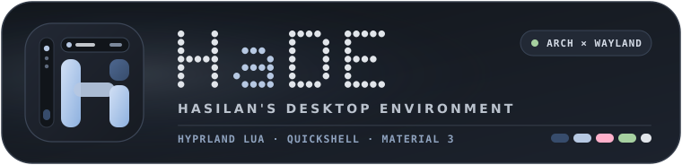
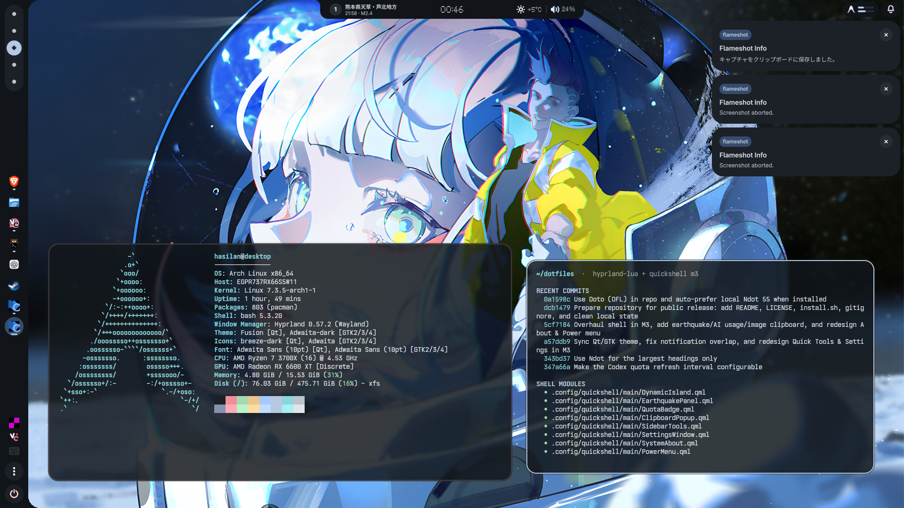
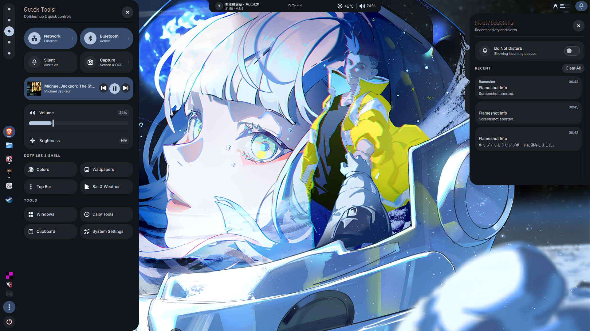
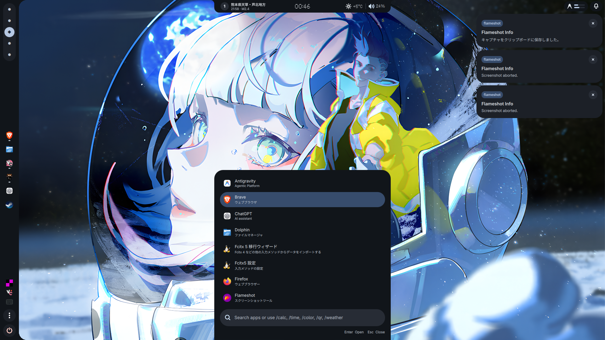
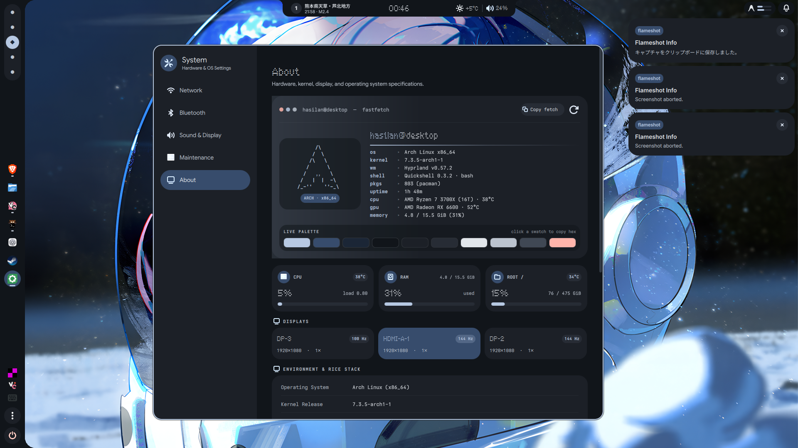
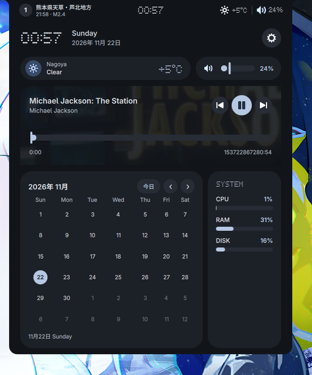
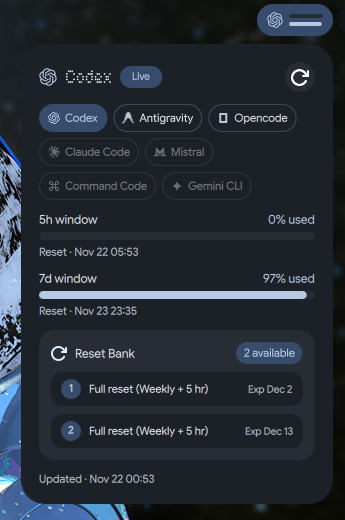
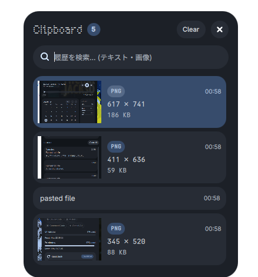
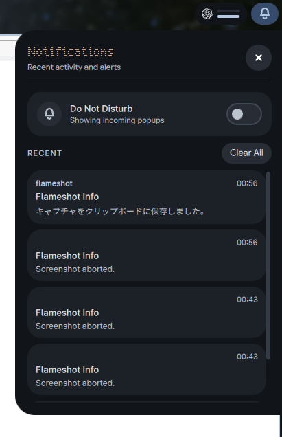
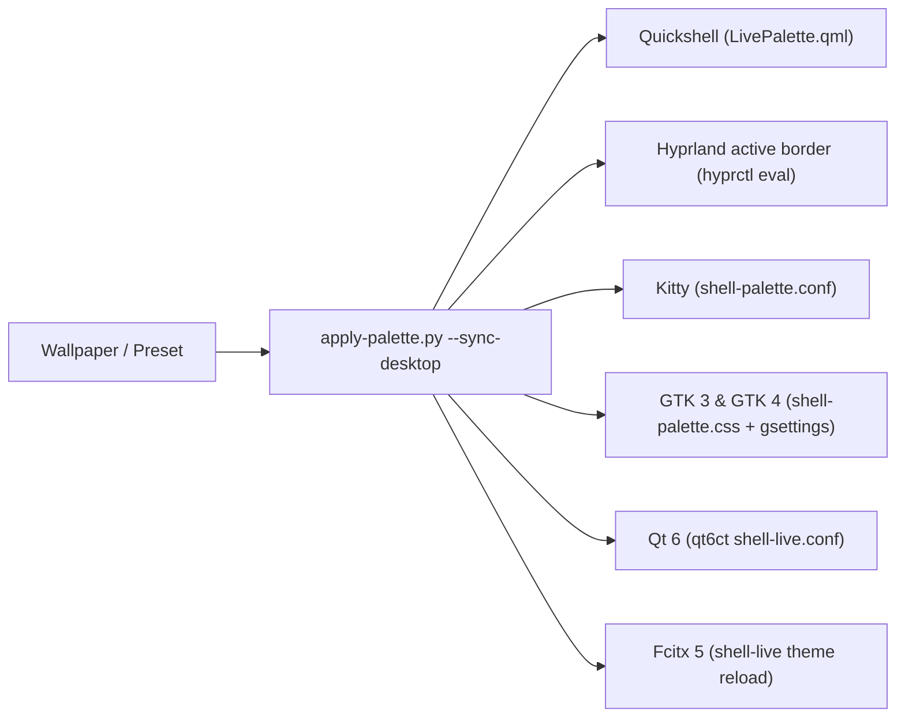

<div align="center">



<br/><br/>

*A wallpaper-reactive **Material Design 3 Expressive** desktop built from scratch in **QML**, **Python**, and **Hyprland Lua** — zero `waybar`, zero `wl-clipboard`, zero external color generators.*

[](https://archlinux.org/)
[](https://github.com/hyprwm/Hyprland)
[](https://git.outfoxxed.me/quickshell/quickshell)
[](#dynamic-material-you-palette-sync)
[](LICENSE)

[Gallery](#gallery) · [Highlights](#highlights) · [Installation](#installation) · [Keybindings](#keybindings) · [IPC & Extending](#ipc--extending) · [Dependencies](#dependencies)

<br/>



*HaDE running on Arch Linux & Hyprland (`0.57.2`) — Dynamic Island with P2PQuake monitor, left rail & taskbar, AI Quota HUD, and blurred floating `kitty` terminals synced to the live wallpaper palette.*

</div>

---

## Gallery

### Full-Screen Views

<table>
  <tr>
    <td width="50%" align="center">
      
      <br/>
      <b>Quick Tools & Notifications</b><br/>
      <sub>Slide-over shell/rice hub (Colors, Wallpapers, Top Bar, Capture, Audio/Brightness, MPRIS player) & live notification center.</sub>
    </td>
    <td width="50%" align="center">
      
      <br/>
      <b>M3 Launcher & Inline Tools</b><br/>
      <sub>Keyboard-driven app launcher, emoji search, and live <code>/calc</code>, <code>/time</code>, <code>/color</code>, <code>/qr</code>, <code>/weather</code>, and <code>/web</code> commands.</sub>
    </td>
  </tr>
  <tr>
    <td colspan="2" align="center">
      
      <br/>
      <b>System Settings — Fastfetch × Material 3 About</b><br/>
      <sub>Unix-porn-inspired hardware & rice overview featuring live hwmon temps, load/RAM/root telemetry, monitor topology cards, clickable live palette swatches, and one-click fetch copy.</sub>
    </td>
  </tr>
</table>

### Component Spotlight

<table>
  <tr>
    <td width="50%" align="center" valign="top">
      
      <br/>
      <b>Dynamic Island Dashboard</b><br/>
      <sub>Expanded pill with P2PQuake alert strip, weather, volume slider, MPRIS artwork player, interactive calendar, and live CPU/RAM/Disk meters.</sub>
    </td>
    <td width="50%" align="center" valign="top">
      
      <br/>
      <b>Multi-Provider AI Usage HUD</b><br/>
      <sub>Live 5h/7d quota tracking and Reset Bank credits across Codex, Antigravity, OpenCode, Claude Code, Mistral, Command Code, and Gemini CLI.</sub>
    </td>
  </tr>
  <tr>
    <td width="50%" align="center" valign="top">
      
      <br/>
      <b>Wayland Image + Text Clipboard</b><br/>
      <sub>Cursor-side popup powered by pure-Python <code>ext_data_control_v1</code> with live image thumbnails, format/dimension badges, search, and text history.</sub>
    </td>
    <td width="50%" align="center" valign="top">
      
      <br/>
      <b>Notification Center</b><br/>
      <sub>Grouped notification history with Do Not Disturb toggle and quick dismiss/clear actions.</sub>
    </td>
  </tr>
</table>

---

## Highlights

### Dynamic Material You Palette Sync
Pick a wallpaper in **Quick Tools → Wallpapers** (or select `Sakura Pink`, `Sky Blue`, `Forest Green`, or `Wallpaper Auto`) and `apply-palette.py` computes a cohesive Material Design 3 dark surface & accent palette in pure Python stdlib (`colorsys`) — then pushes it live across your entire desktop:



No external `matugen`, `pywal`, or `wallust` setup required.

---

### Custom Quickshell Architecture (`main`)

- **Dynamic Island (`DynamicIsland.qml`)**:
  - Top-center pill that smoothly morphs into expanded drawers using M3 Shared Axis / Emphasized easing curves.
  - **Built-in Left Slot Modes**:
    - **Music & Active Window (`IslandMusic.qml`)**: MPRIS track & playback state.
    - **Real-time Earthquake Monitor (`IslandEarthquake.qml`, `EarthquakePanel.qml`, `earthquake-ws.py`)**: Powered by the P2PQuake API (`codes=551`), featuring a zero-dependency RFC 6455 WebSocket client (`LIVE` badge) or configurable interval polling (`30s`, `1m`, `5m`), plus JMA seismic intensity badges.
    - **Custom QML Slot ([`ISLAND-EXTENSIONS.md`](.config/quickshell/main/ISLAND-EXTENSIONS.md))**: Drop in your own `165×32` QML widget from **Quick Tools → Top Bar** (includes [`VM600PEBattery.qml`](.config/quickshell/main/VM600PEBattery.qml) as a real hardware plugin example).
- **Cursor-Side Wayland Clipboard (`Super + V`)**:
  - [`clipboard-daemon.py`](.config/quickshell/main/clipboard-daemon.py) speaks Wayland **`ext_data_control_v1`** (with `zwlr_data_control_manager_v1` fallback) directly over Unix domain sockets in pure Python — **no `wl-clipboard` or `cliphist` needed**.
  - Captures both **text** and **images** (`PNG`, `WebP`, `JPEG`, `GIF`, `BMP`) with inline thumbnails, image dimensions, file size badges, SHA-256 deduplication, search filtering, keyboard navigation (`↑` `↓` `Enter` `Esc`), and one-click re-offering to the Wayland selection.
- **Multi-Provider AI Usage HUD (`QuotaBadge.qml`, `ai-usage.py`)**:
  - Top-right status pill tracking session/weekly usage across **Codex CLI** (`app-server` + reset credit bank), **Antigravity**, **OpenCode**, **Claude Code**, **Mistral**, **Gemini CLI**, and **Command Code**, with auto-detection or manual provider pinning.
- **Raycast-Style Launcher (`Super + Space`) & Utilities (`launcher-tools.py`)**:
  - Fuzzy app search, right-click pin/unpin to left taskbar, Emoji picker (`Super + .`), and live `/` utilities:

  | Command | Example | Result |
  | :--- | :--- | :--- |
  | `/calc` | `/calc 2pi + sqrt(9)` | Safe AST math evaluator (`sin`, `cos`, `tan`, `log`, `ln`, `pi`, `tau`) |
  | `/time` | `/time tokyo to london` · `/time 23:30 + 2h - 15m` | Timezone conversion & clock duration arithmetic |
  | `/color` | `/color #b6c8e2` · `/color rgb(182, 200, 226)` | Converts between `HEX`, `rgb()`, and `hsl()` with live swatch preview |
  | `/qr` | `/qr https://github.com/seipass/dotfiles` | Offline SVG QR code generation directly in the launcher |
  | `/weather` | `/weather Tokyo` | 3-day forecast via `wttr.in` |
  | `/web` | `/web hyprland lua rules` | Opens DuckDuckGo search in your browser |

- **Clean Separation: Quick Tools vs System Settings**:
  - **Quick Tools (`SidebarTools.qml`)**: Your dotfiles & daily hub — Colors, Wallpapers, Dynamic Island mode, Bar toggles, Weather city search (Open-Meteo Geocoding), Screen Capture/OCR/Translate, Window overview (`ScreencopyView` live thumbnails), Focus Timer & Notes, Clipboard, plus mini Network/Bluetooth/Silent/Media/Volume/Brightness controls.
  - **System Settings (`SettingsWindow.qml`)**: OS & hardware panel — Wi-Fi (`nmcli`), Bluetooth (`bluetoothctl`), PipeWire audio (`wpctl`), DDC/CI & backlight (`monitor-brightness.py`), Maintenance (`htop`, `journalctl`, `checkupdates`, shell reload), and the **Fastfetch × M3 About** page (`SystemAbout.qml` + `system-info.py`).
- **Accessible Power Menu (`PowerMenu.qml`)**:
  - Full-width, high-contrast Shutdown hero button with two-step safety confirmation, keyboard focus navigation (`Tab` / arrows / `Enter` / `Space` / `Esc`), Reboot, Suspend, and Hyprland Logout.

### Afterglow SDDM Theme (`Qt6`)
Located at [`.local/share/sddm/themes/afterglow`](.local/share/sddm/themes/afterglow) — a matching Material Design 3 greeter with customizable [`theme.conf`](.local/share/sddm/themes/afterglow/theme.conf) color tokens, user quick-select chips, show/hide password toggle, session switcher, power buttons, and `Esc` to exit cleanly in `--test-mode`.

---

## Installation

### 1. Install Dependencies (Arch Linux)

**Core stack** (verified on a live setup):

```bash
sudo pacman -S --needed \
  hyprland quickshell kitty pipewire wireplumber \
  networkmanager network-manager-applet bluez-utils \
  qt6ct qt6-declarative qt6-svg qt6-5compat \
  xdg-desktop-portal xdg-desktop-portal-hyprland xdg-desktop-portal-gtk \
  python python-dbus glib2 curl grim slurp flameshot htop dolphin wofi \
  breeze-icons adwaita-icon-theme noto-fonts-cjk
```

**Optional packages** (enable extra Quick Tools / Maintenance features if present):

```bash
sudo pacman -S --needed \
  fcitx5 fcitx5-mozc \
  playerctl ddcutil brightnessctl pavucontrol \
  tesseract tesseract-data-eng pacman-contrib sddm
```

> Also install `Ioskeley Mono Term` (or set your preferred monospace font in `kitty.conf`, `qt6ct.conf`, and `Theme.js`). `Doto` and `Google Sans Flex` are bundled under SIL OFL 1.1.

### 2. Clone & Install

```bash
git clone https://github.com/seipass/dotfiles.git ~/dotfiles
cd ~/dotfiles

./install.sh --dry-run   # preview every action safely first
./install.sh             # backs up existing configs to ~/.local/state/dotfiles-backup-*
```

To also install the **Afterglow** SDDM theme into `/usr/share/sddm/themes/afterglow`:

```bash
./install.sh --with-sddm
```

Then enable it in `/etc/sddm.conf.d/afterglow.conf`:

```ini
[Theme]
Current=afterglow
```

### 3. Post-Install Adjustments
1. **Monitor Layout**: Edit `hl.monitor(...)` outputs (`DP-3`, `HDMI-A-1`, `DP-2`) in `~/.config/hypr/hyprland.lua` to match `hyprctl monitors`.
2. **Keyboard Layout**: Update `kb_layout = "jp"` in `~/.config/hypr/hyprland.lua` if you use another layout (e.g. `"us"`).
3. **Typography (`Doto` vs `Ndot 55`)**: By default, HaDE renders display headings with the bundled open-source **`Doto`** font. If you happen to have **`Ndot 55`** installed locally on your system, [`Theme.js`](.config/quickshell/main/Theme.js) and Afterglow [`Main.qml`](.local/share/sddm/themes/afterglow/Main.qml) automatically detect and prefer it without modifying a single line of config.

---

## Keybindings

Defined in [`.config/hypr/hyprland.lua`](.config/hypr/hyprland.lua):

| Keybind | Action |
| :--- | :--- |
| `Super + Return` | Launch `kitty` |
| `Super + Space` | Toggle M3 Launcher (`/calc`, `/time`, `/color`, `/qr`, `/weather`, `/web`) |
| `Super + .` | Open Emoji Picker |
| `Super + V` | Toggle Cursor-Side Clipboard History (Text & Images) |
| `Super + Shift + V` | Toggle active window floating |
| `Super + Shift + S` | Screenshot active pointer monitor with Flameshot (`flameshot-screen.py`) |
| `Super + F` | Toggle fullscreen |
| `Super + Q` / `Super + C` | Close active window |
| `Super + E` | Open file manager (`dolphin`) |
| `Super + R` | Open `wofi` |
| `Super + P` / `Super + J` | Pseudo-tile / Toggle split |
| `Super + S` / `Super + Alt + S` | Toggle / move window to scratchpad (`special:magic`) |
| `Super + Arrows` | Move window focus |
| `Super + [0-9]` / `Shift + [0-9]` | Switch to / move window to workspace `1–10` |
| `Super + LMB` / `Super + RMB` | Drag / resize floating or tiled windows |
| `XF86Audio*` / `XF86MonBrightness*` | PipeWire volume (`wpctl`), backlight (`brightnessctl`), media (`playerctl`) |

---

## IPC & Extending

Inspect or script the running shell via Quickshell IPC:

```bash
qs ipc --config main call launcher toggle
qs ipc --config main call launcher emoji
qs ipc --config main call clipboard toggle
qs ipc --config main call settings openPage 4          # 0:Net 1:BT 2:Sound 3:Maint 4:About
qs ipc --config main call quickTools_HDMI-A-1 toggle   # replace HDMI-A-1 with your output
qs ipc --config main call alerts_HDMI-A-1 toggle
qs ipc --config main call palette select pink          # auto | pink | blue | green
```

To build your own left-slot **Dynamic Island** widget, read [`ISLAND-EXTENSIONS.md`](.config/quickshell/main/ISLAND-EXTENSIONS.md) and reference [`VM600PEBattery.qml`](.config/quickshell/main/VM600PEBattery.qml).

---

## Directory Structure

```text
.
├── .config/
│   ├── fcitx5/conf/classicui.conf
│   ├── gtk-3.0/               # gtk.css, settings.ini, shell-palette.css
│   ├── gtk-4.0/               # gtk.css, settings.ini, shell-palette.css
│   ├── hypr/                  # hyprland.lua, flameshot-screen.py, generated-accent
│   ├── kitty/                 # kitty.conf, shell-palette.conf
│   ├── qt6ct/                 # qt6ct.conf, colors/shell-live.conf
│   ├── quickshell/main/       # M3 QML components, Dynamic Island & Python helpers
│   ├── user-dirs.dirs
│   └── user-dirs.locale
├── .local/share/
│   ├── fcitx5/themes/         # caelestia-shell & shell-live Fcitx5 themes
│   └── sddm/themes/afterglow/ # M3 Qt6 SDDM theme & theme.conf
├── assets/                    # HaDE banner logo & emblem icon (SVG)
├── screenshots/               # Showcase captures
├── install.sh                 # Backup-safe installer (--copy / --link / --with-sddm)
├── LICENSE
└── README.md
```

---

## Credits & Licensing

- **HaDE** original QML, Lua, Python, and shell scripts are licensed under the **[MIT License](LICENSE)**.
- **`Doto.ttf`**: SIL Open Font License 1.1 — The Doto Project Authors ([`Doto-OFL.txt`](.config/quickshell/main/fonts/Doto-OFL.txt)).
- **`GoogleSansFlex.ttf`**: SIL Open Font License 1.1 — The Google Sans Flex Authors ([`OFL.txt`](.config/quickshell/main/fonts/OFL.txt)).
- **`codex-badge.svg`**: Mozilla Public License 2.0 ([`codex-badge-LICENSE`](.config/quickshell/main/codex-badge-LICENSE)).
- **`launcher-data/`**: Bundled emoji dataset & pure-Python QR encoder ([`emoji-LICENSE`](.config/quickshell/main/launcher-data/emoji-LICENSE), [`qrcode-LICENSE`](.config/quickshell/main/launcher-data/qrcode-LICENSE)).
